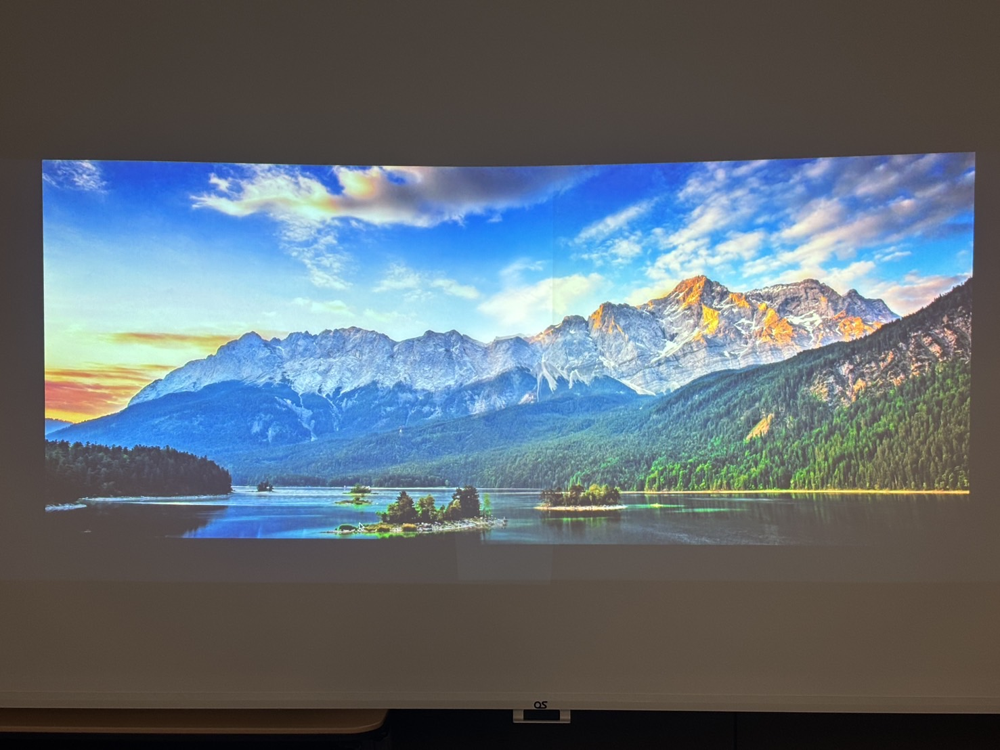
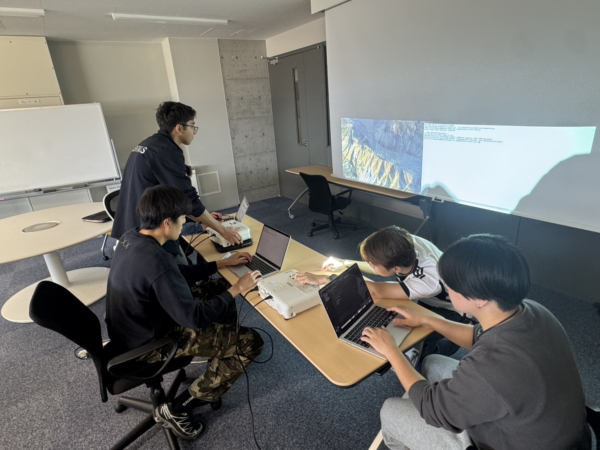

# Final documentation — easy reading guide

[Professor guide](../PROFESSOR_START_HERE.md) · [Complete final package](final-deliverable-2026-11-12/README.md) · [Run the software](setup.md)

This guide explains the team's final documentation and shows its supplied images. The original manual, class reference and source files are preserved in the final package.

## 1. What the project does

Two projectors display parts of one wide image. Their images overlap in the middle. The software applies brightness masks in that overlap so the combined picture can appear more uniform.

The team's presentation reports tests at different gamma values, including improved brightness uniformity at gamma 2.2 in the shown test. Projector position and alignment still affect the result. See [presentation pages 3–10](../Presentation/PBL4-G1-Presentation-2026-11-12.pdf) for the reported settings, findings and remaining checks.

## 2. How it works

1. Read the projector settings and input image.
2. Calculate the overlap and split the image for the left and right projectors.
3. Apply a brightness mask across the overlapping area.
4. Display the two outputs and adjust the physical projector alignment.

The manual describes the gamma adjustment as **M(x) = B(x)^(1/gamma)**, where B(x) is a brightness ramp from 0 to 1 and M(x) is the resulting mask.

## 3. Images supplied with the final manual

### Left and right inputs

| Left projector input | Right projector input |
| --- | --- |
|  |  |

### Blended-result illustration

### Projector photograph

### Team photograph

These are the team's supplied illustrations and photographs. They are not independent measurements of image quality.

## 4. Software structure described in the manual

| Class | Purpose described in the documentation |
| --- | --- |
| MainAlphaBlender | Coordinates the processing and display |
| ConfigReader | Reads the configuration values |
| ImageReadWrite | Loads and outputs image data |
| CropImage | Splits the input for the projectors |
| CalculateOverlap | Calculates the overlap |
| MaskCreator | Creates the blending mask |

The final documentation contains class skeletons with placeholder methods. The runnable software remains in [Development](../Development/README.md); use its [setup guide](setup.md) for commands and configuration.

## 5. Open the complete manual

1. [Download the full project ZIP](https://github.com/daitera1/PBL4-G1/archive/refs/heads/main.zip) and extract it.
2. Double-click **START_HERE.html**.
3. Select **Final manual** to open the full user manual, class pages and navigation.

The manual file is `Documentation/final-deliverable-2026-11-12/html/index.html`. Keep its neighbouring files together. No Drive account is needed. The manual's text, pictures and navigation are local; equation typesetting uses an external MathJax service.

## 6. What is included

The final package contains **231 original deliverable files**: generated HTML, Doxygen configuration, documentation source, class skeletons, LaTeX files and image assets. Every copied file's size was checked against Drive metadata, and all **973 local HTML references** resolve.

[Final package contents and source](final-deliverable-2026-11-12/README.md) · [File inventory](drive-source-inventory.csv) · [Full verification notes](verification.md)
