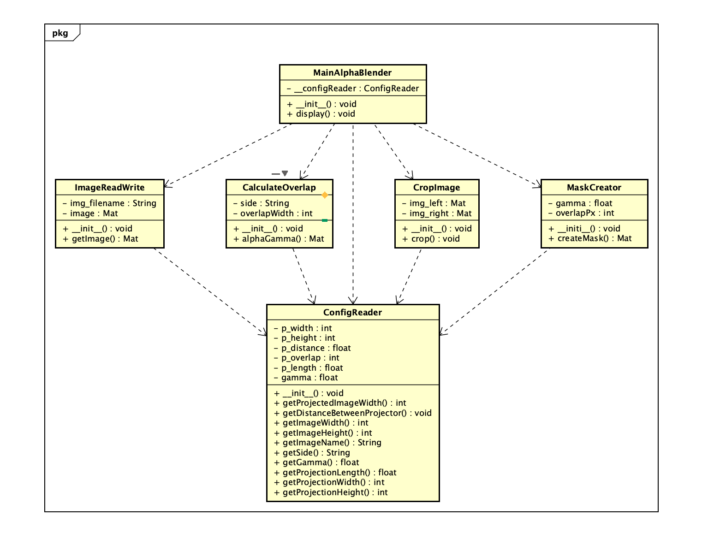

# Design and architecture

*Original team screenshot from the shared Drive, dated 29 October 2026. This records the design at that time; it is not a claim that every interface matches the current code.*

- [Editable Astah class diagram](Class%20Diagram%20PBL4%20G1.asta) — Drive file last modified 18 October 2026; older than the screenshot above.
- [Historical overview and design document](Project-Overview-and-Design-HISTORICAL.docx) — original PG1-11 attachment.
- [Current software run guide](../setup.md).
