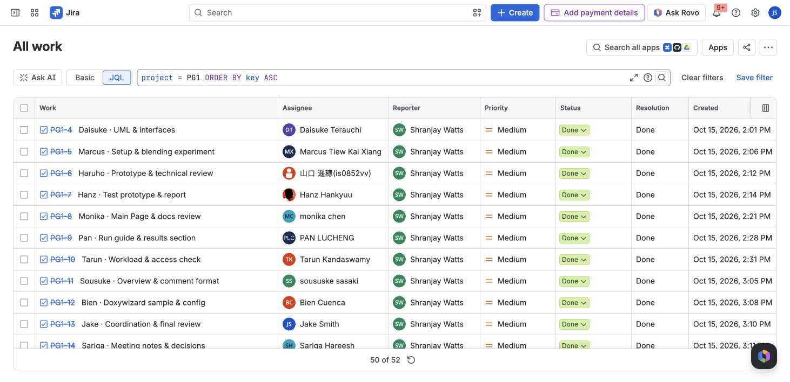

# Jira · final project register

**PG1 · 52 tickets · 12 team members · all Done**

Final export: **12 November 2026**, after project closeout at 11:48 JST.

| Done | In progress | To do |
| ---: | ---: | ---: |
| 52 | 0 | 0 |

[CSV](PG1-2026-11-12.csv) · [JSON](PG1-2026-11-12.json) · [Screenshots](screenshots/README.md) · [Closeout record](closeout-2026-11-12.md) · [Professor guide](../../PROFESSOR_START_HERE.md)

The remaining 34 tickets were transitioned to Done following Jake's confirmation that the project was finished; 18 were already Done. A fresh export and an empty open-ticket search confirm the final tracker state. Ticket closure does not add new hardware test evidence, validate the historical workload figures, or rewrite original descriptions.

The screenshot shows the first visible rows; the CSV, JSON and table below contain all 52 records. Jira's “50 of 52” footer is a page-size limit.

## Team completion

| Assignee (as recorded in Jira) | Done | Open |
| --- | ---: | ---: |
| Bien Cuenca | 3 | 0 |
| Daisuke Terauchi | 3 | 0 |
| Hanz Hankyuu | 3 | 0 |
| Jake Smith | 10 | 0 |
| Marcus Tiew Kai Xiang | 3 | 0 |
| PAN LUCHENG | 3 | 0 |
| Sariga Hareesh | 3 | 0 |
| Shranjay Watts | 6 | 0 |
| Tarun Kandaswamy | 3 | 0 |
| monika chen | 6 | 0 |
| soususke sasaki | 3 | 0 |
| 山口 遥穂(is0852vv) | 6 | 0 |

## All tickets

| Issue | Task | Owner | Status |
| --- | --- | --- | --- |
| [PG1-4](issues/PG1-4.md) | Daisuke · UML & interfaces | Daisuke Terauchi | Done |
| [PG1-5](issues/PG1-5.md) | Marcus · Setup & blending experiment | Marcus Tiew Kai Xiang | Done |
| [PG1-6](issues/PG1-6.md) | Haruho · Prototype & technical review | 山口 遥穂(is0852vv) | Done |
| [PG1-7](issues/PG1-7.md) | Hanz · Test prototype & report | Hanz Hankyuu | Done |
| [PG1-8](issues/PG1-8.md) | Monika · Main Page & docs review | monika chen | Done |
| [PG1-9](issues/PG1-9.md) | Pan · Run guide & results section | PAN LUCHENG | Done |
| [PG1-10](issues/PG1-10.md) | Tarun · Workload & access check | Tarun Kandaswamy | Done |
| [PG1-11](issues/PG1-11.md) | Sousuke · Overview & comment format | soususke sasaki | Done |
| [PG1-12](issues/PG1-12.md) | Bien · Doxywizard sample & config | Bien Cuenca | Done |
| [PG1-13](issues/PG1-13.md) | Jake · Coordination & final review | Jake Smith | Done |
| [PG1-14](issues/PG1-14.md) | Sariga · Meeting notes & decisions | Sariga Hareesh | Done |
| [PG1-15](issues/PG1-15.md) | Watts · Jira & evidence handover | Shranjay Watts | Done |
| [PG1-16](issues/PG1-16.md) | Add everyone's email and assign initial tasks | Shranjay Watts | Done |
| [PG1-17](issues/PG1-17.md) | Assign Jake and Sosuke | Shranjay Watts | Done |
| [PG1-18](issues/PG1-18.md) | main page | Shranjay Watts | Done |
| [PG1-19](issues/PG1-19.md) | Week 3 Development — Haruho | 山口 遥穂(is0852vv) | Done |
| [PG1-20](issues/PG1-20.md) | Week 3 Documentation — Monika | monika chen | Done |
| [PG1-21](issues/PG1-21.md) | Week 3 Management — Jake | Jake Smith | Done |
| [PG1-22](issues/PG1-22.md) | Final presentation · 12 Nov · 5–7 min | Jake Smith | Done |
| [PG1-23](issues/PG1-23.md) | Haruho · Development slides & demo | 山口 遥穂(is0852vv) | Done |
| [PG1-24](issues/PG1-24.md) | Monika · Documentation slides & evidence | monika chen | Done |
| [PG1-25](issues/PG1-25.md) | Jake · Combine deck & management slides | Jake Smith | Done |
| [PG1-26](issues/PG1-26.md) | Team · Rehearse & polish presentation | Jake Smith | Done |
| [PG1-27](issues/PG1-27.md) | Week 4 — Team tasks and review | Jake Smith | Done |
| [PG1-28](issues/PG1-28.md) | Daisuke · Week 4 repository and UML review | Daisuke Terauchi | Done |
| [PG1-29](issues/PG1-29.md) | Marcus · Week 4 cropping and blending experiment | Marcus Tiew Kai Xiang | Done |
| [PG1-30](issues/PG1-30.md) | Haruho · Week 4 runnable prototype and technical review | 山口 遥穂(is0852vv) | Done |
| [PG1-31](issues/PG1-31.md) | Hanz · Week 4 prototype testing and results | Hanz Hankyuu | Done |
| [PG1-32](issues/PG1-32.md) | Bien · Week 4 Doxygen package and asset check | Bien Cuenca | Done |
| [PG1-33](issues/PG1-33.md) | Sousuke · Week 4 architecture and comment review | soususke sasaki | Done |
| [PG1-34](issues/PG1-34.md) | Pan · Week 4 run guide and verified results | PAN LUCHENG | Done |
| [PG1-35](issues/PG1-35.md) | Monika · Week 4 documentation integration and review | monika chen | Done |
| [PG1-36](issues/PG1-36.md) | Tarun · Week 4 workload and access follow-up | Tarun Kandaswamy | Done |
| [PG1-37](issues/PG1-37.md) | Sariga · Week 4 meeting decisions and blockers | Sariga Hareesh | Done |
| [PG1-38](issues/PG1-38.md) | Watts · Week 4 Jira evidence and delivery package | Shranjay Watts | Done |
| [PG1-39](issues/PG1-39.md) | Jake · Week 4 coordination and final review | Jake Smith | Done |
| [PG1-40](issues/PG1-40.md) | Week 5 · Evidence review and professor handover | Jake Smith | Done |
| [PG1-41](issues/PG1-41.md) | Jake · Week 5 department review and evidence index | Jake Smith | Done |
| [PG1-42](issues/PG1-42.md) | Watts · Week 5 portable project archive and ZIP check | Shranjay Watts | Done |
| [PG1-43](issues/PG1-43.md) | Jake · Week 5 professor walkthrough and acceptance review | Jake Smith | Done |
| [PG1-44](issues/PG1-44.md) | Monika · Week 5 documentation integration and review | monika chen | Done |
| [PG1-45](issues/PG1-45.md) | Haruho · Week 5 development integration and validation | 山口 遥穂(is0852vv) | Done |
| [PG1-46](issues/PG1-46.md) | Tarun · Week 5 workload and handover readiness check | Tarun Kandaswamy | Done |
| [PG1-47](issues/PG1-47.md) | Sariga · Week 5 meeting decisions and follow-up register | Sariga Hareesh | Done |
| [PG1-48](issues/PG1-48.md) | Monika · Week 5 generated documentation review and sign-off | monika chen | Done |
| [PG1-49](issues/PG1-49.md) | Pan · Week 5 Main Page and comment consistency check | PAN LUCHENG | Done |
| [PG1-50](issues/PG1-50.md) | Sousuke · Week 5 overview, design and comment-format review | soususke sasaki | Done |
| [PG1-51](issues/PG1-51.md) | Bien · Week 5 Doxygen configuration and offline asset check | Bien Cuenca | Done |
| [PG1-52](issues/PG1-52.md) | Haruho · Week 5 runnable build integration and technical review | 山口 遥穂(is0852vv) | Done |
| [PG1-53](issues/PG1-53.md) | Daisuke · Week 5 repository and UML consistency check | Daisuke Terauchi | Done |
| [PG1-54](issues/PG1-54.md) | Marcus · Week 5 cropping and blending validation evidence | Marcus Tiew Kai Xiang | Done |
| [PG1-55](issues/PG1-55.md) | Hanz · Week 5 regression tests and defect register | Hanz Hankyuu | Done |

## Earlier snapshots and public export

[11 November CSV](PG1-2026-11-11.csv) · [11 November JSON](PG1-2026-11-11.json) · [9 November CSV](history/PG1-2026-11-09.csv) · [5 November CSV](history/PG1-2026-11-05.csv)

Earlier snapshots retain the statuses recorded on those dates. The current issue pages reflect the final 12 November snapshot.

Public exports retain project descriptions, owners, dates and relationships while omitting internal account IDs, watchers, administrative fields and email addresses. The original all-fields export remains in the local project archive. Live Jira links may require access; all records and screenshots here can be reviewed without a Jira account.
