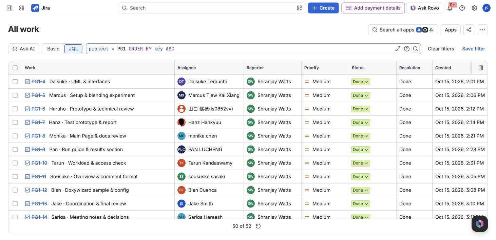
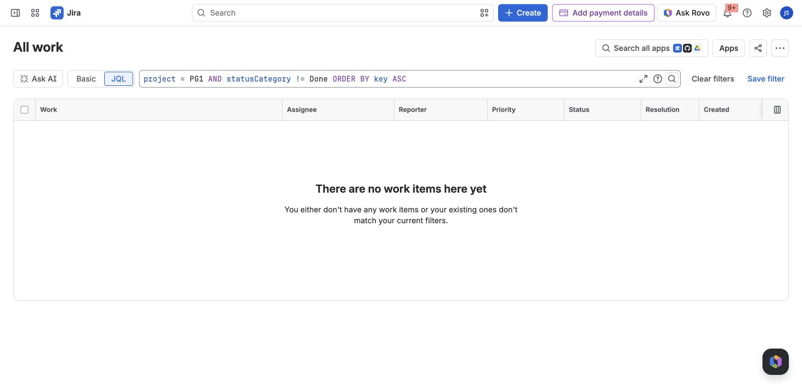
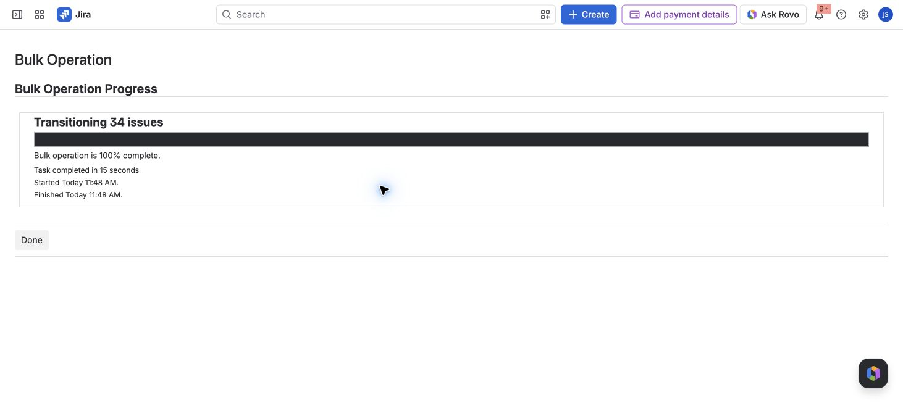
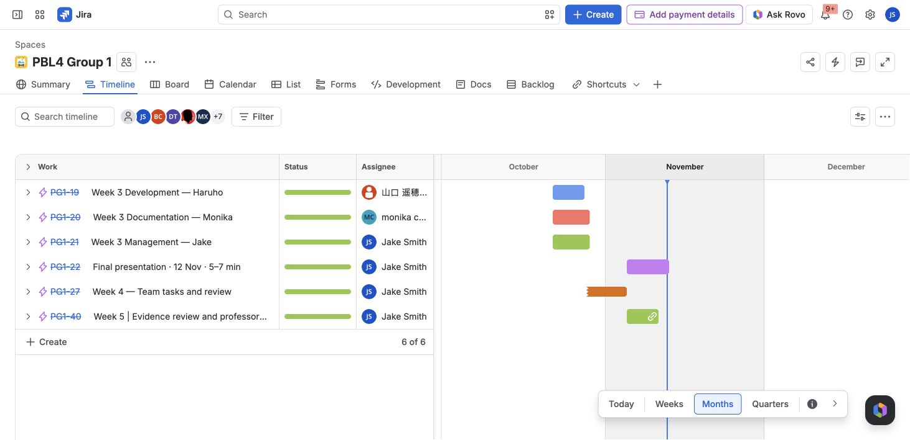
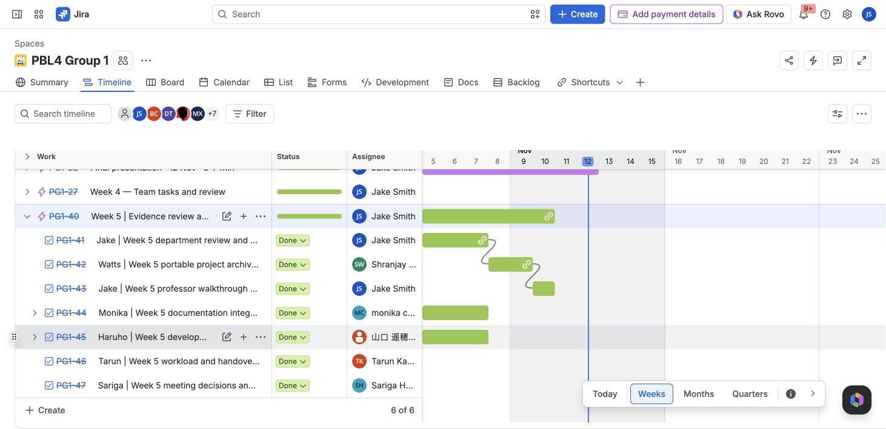
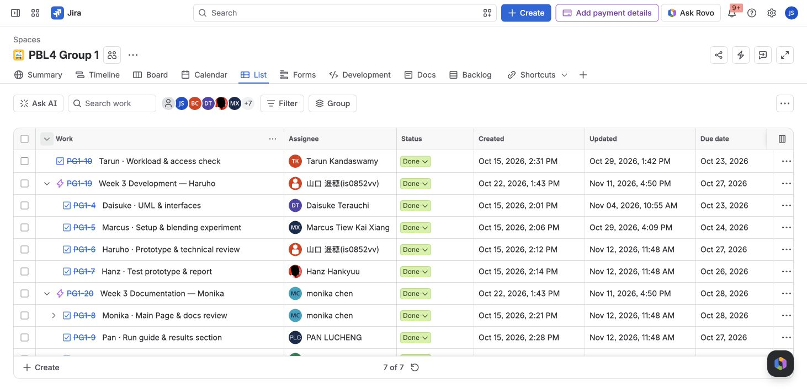
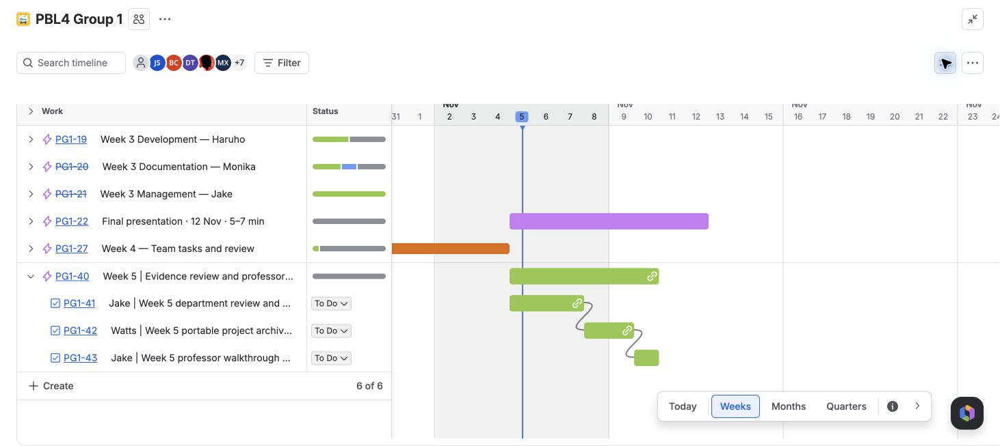

# Jira screenshots

Captured from the live PG1 Jira project on **12 November 2026**, after final closeout. These images are stored in GitHub and require no Jira login. [Final register: 52 / 52 Done](../README.md) · [Closeout details](../closeout-2026-11-12.md)

## Final ticket register

Visible task rows show Done. The “50 of 52” footer is Jira's page-size limit; the [export](../PG1-2026-11-12.csv) includes all 52 tickets.

## No open tickets

The query checks every PG1 ticket whose status category is not Done. It returns no work items.

## Closeout completed

Jira completed the transition of 34 remaining tickets. Eighteen tickets were already Done before this operation.

## Schedule overview and shared table

Captured **12 November 2026** during the professor review cleanup. Gantt bars retain the original planned dates; green indicators and Done labels show the tracker state at capture time, not completion on the bar end dates.

The shared List view keeps owners, status and original audit dates visible. Expand parent rows for the tasks underneath. The footer counts top-level rows when hierarchy is enabled; the [export](../PG1-2026-11-12.csv) contains all 52 tickets.

## Historical Week 5 dependencies

The following **5 November 2026** screenshot preserves the earlier handoff/dependency planning view; it is not the final status view.

