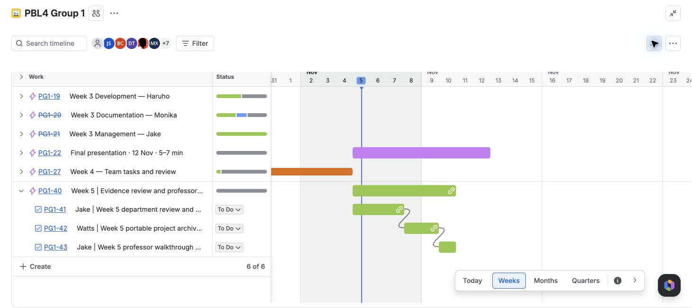

# Planning and Gantt

Historical coordination plans and schedules. Dates represent planned work, not verified completion.

*Captured 5 November 2026: PG1-41 → PG1-42 → PG1-43. Statuses and presentation requirements in this historical image may differ from later records.*

- [Gantt schedule](Gantt-Schedule.md)
- [Assigned tasks and deadlines](Week-3-Assigned-Tasks-and-Deadlines.md)
- [Coordination plan](Jake-Week-3-Coordination-Plan.md)
