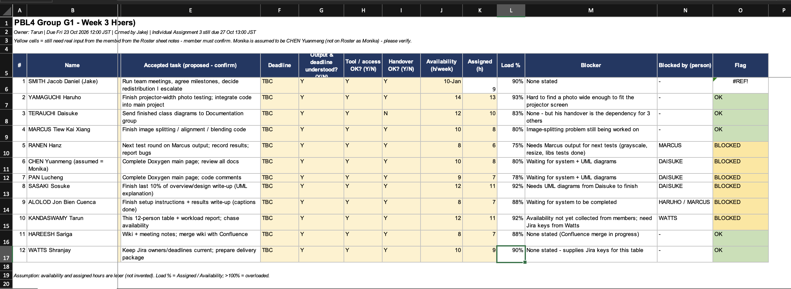
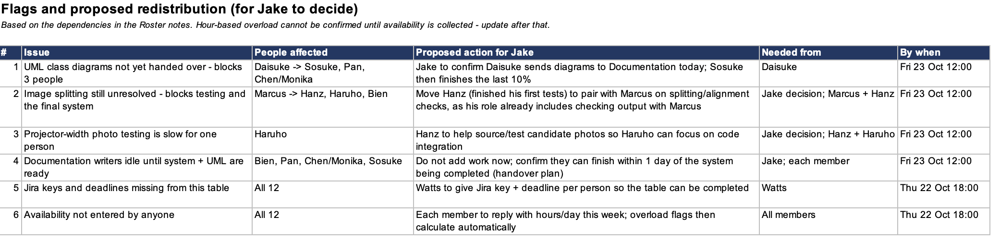

# Tarun — workload and coordination records

[Professor guide](../../PROFESSOR_START_HERE.md) · [Management overview](../README.md)

**Contributor: Tarun Kandaswamy.** The team supplied these two screenshots on 12 November 2026 and identified them as Tarun's work. They show the Week 3 workload table and proposed responses to blockers.

## 1. Team workload table

The table covers 12 members: assigned work, deadlines, access, handover readiness, availability, assigned hours and blockers.

[Open the full-size workload screenshot](Tarun-Week-3-Workload.png)

## 2. Flags and proposed redistribution

This sheet identifies dependencies and suggests actions for Jake to decide. The proposals shown are summarised below; the screenshot retains the original wording and deadlines.

| Issue recorded | Proposed response |
| --- | --- |
| UML diagrams had not been handed over | Ask Daisuke to send diagrams so documentation work can continue |
| Image splitting was unresolved | Pair Hanz with Marcus for splitting and alignment checks |
| Projector-width photo testing was slow | Have Hanz help Haruho source and test candidate photos |
| Documentation depended on the system and UML | Confirm a handover plan and the writers' availability |
| Jira keys and deadlines were missing from the table | Ask Watts to provide the issue key and deadline for each person |
| Member availability had not been collected | Collect hours per day before confirming overload flags |

[Open the full-size flags and redistribution screenshot](Tarun-Week-3-Flags-and-Redistribution.png)

## How to read these records

These are historical planning records, with deadlines shown for 22–23 October. They are not the final project status or verified time tracking. The screenshots retain their original unconfirmed entries, `TBC` values and visible spreadsheet error. Proposed redistribution is not evidence that the actions were approved or completed.

The [original editable workload workbook](Workload-Table-UNCONFIRMED.xlsx) is also preserved. For the final task status, see the [12 November Jira register](../jira/README.md).

Both screenshots were copied unchanged from the images supplied by the team.
