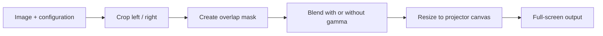

<div align="center">

# PBL4 · Group 1

### Multi-projector image blending

**Development · Documentation · Project management**

[Run the project](docs/setup.md) · [Read the documentation](docs/README.md) · [Browse Jira records](project-management/jira/README.md) · [Find the data](data/README.md)

</div>

---

A shared home for the Python image-blending system, technical documentation, UML design, project data and team records. The implementation contains two variants for comparing blending with and without gamma compensation.

## Start here

| I want to… | Open |
| --- | --- |
| Run the software | [Setup and run guide](docs/setup.md) |
| Inspect the baseline implementation | [ImageBlendingNoGamma](ImageBlendingNoGamma/) |
| Inspect gamma compensation | [ImageBlendingWithGamma](ImageBlendingWithGamma/) |
| Read the team's Doxygen documentation | [Documentation index](docs/README.md) |
| Find UML and design files | [Design documents](docs/design/) |
| Review tasks, owners and deadlines | [Jira archive — 52 records](project-management/jira/README.md) |
| Review plans, meeting records and workload | [Project management](project-management/README.md) |
| Find images, parameters and structured data | [Data index](data/README.md) |
| Trace where the files came from | [Collection notes and source inventory](docs/collection-notes.md) |

## How the software fits together



## Repository map

```text
ImageBlendingNoGamma/     Baseline Python implementation and sample input
ImageBlendingWithGamma/   Gamma-compensated implementation and sample input
docs/                    Run guide, Drive documentation and design files
project-management/      Jira, planning, team wiki and workload records
data/                    Index of sample inputs, configuration and project datasets
requirements.txt         Python dependencies used by the implementation
```

## Reading the evidence

Collected **12 November 2026**. Jira records are a **11 November 2026 snapshot**: 18 Done, 1 In Progress and 33 To Do. Historical plans and draft documentation retain their dates; task status alone does not prove a tested deliverable. See the collection notes for source coverage and known gaps.

To browse generated HTML offline, download the repository using **Code → Download ZIP**, extract it, and open the documentation index listed in [docs/README.md](docs/README.md). GitHub shows HTML source rather than running these pages.

## Team

| Department | Members |
| --- | --- |
| Development | Haruho, Daisuke, Marcus, Hanz |
| Documentation | Monika, Sousuke, Bien, Pan |
| Management | Jake, Tarun, Sariga, Watts |

Team records are preserved under project management. Keep new evidence with its date and source, and update the relevant index when adding files.
