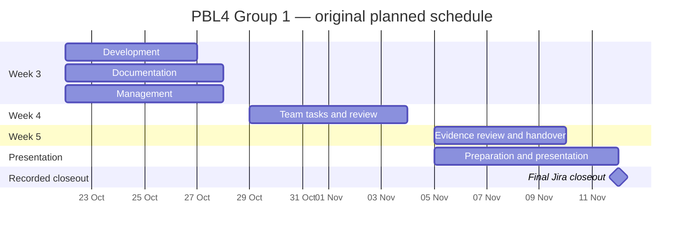

# Weekly progress and final review

**PBL4 · Group 1 · Review index prepared 12 November 2026**

[Professor start page](../PROFESSOR_START_HERE.md) · [All 52 tickets](jira/README.md) · [Jira screenshots](jira/screenshots/README.md) · [Live Jira timeline](https://ed-team-fqz0grjq.atlassian.net/jira/software/projects/PG1/boards/2/timeline?rangeMode=WEEKS)

## Project at a glance

| People | Final tracker status | Software | Documentation |
| --- | --- | --- | --- |
| 12 members across 3 departments | 52 / 52 Done on 12 November | Baseline and gamma-compensated Python implementations | Dated Doxygen packages, UML, guides and team records |

This retrospective index connects existing weekly plans, saved progress notes, dated files and Jira exports. The Gantt dates below are the original planned windows. Ticket status reflects the date of each saved export; it does not establish the exact date the underlying work was performed.

## Weekly work and available evidence

| Period | Assigned focus | Records to review |
| --- | --- | --- |
| Week 3 · 22–28 October | UML and interfaces; blending prototype; testing; Doxygen setup; run guide; documentation integration; workload, decisions and coordination | [12-person schedule](planning/Gantt-Schedule.md), [Week 3 record](wiki/Week-3-Progress.md), [22 October documentation snapshot](../docs/drive/main-page-2026-10-22/) |
| Week 4 · 29 October–4 November | Repository/UML review; cropping and blending; prototype tests; documentation package; architecture/comments; team review | [Week 4 task group](jira/issues/PG1-27.md), [29 October documentation snapshot](../docs/drive/main-page-2026-10-29/), [Weeks 4–5 progress notes](wiki/Week-4-5-Progress.md) |
| Week 5 · 5–10 November planned handover | Department reviews; evidence index; portable archive; documentation/build checks; professor walkthrough | [Week 5 task group](jira/issues/PG1-40.md), [5 November documentation snapshot](../docs/drive/main-page-2026-11-05/), [dependency screenshot](planning/Week05-Jira-Gantt-dependencies.png) |
| Presentation preparation · 5–12 November | Department content; combined deck; rehearsal; final presentation milestone | [Presentation task group](jira/issues/PG1-22.md), [original preparation targets](planning/Gantt-Schedule.md#final-presentation--12-november) |
| Final closeout · 12 November | Final GitHub handover, access checks and Jira closeout following the team's completion confirmation | [Closeout record](jira/closeout-2026-11-12.md), [final export](jira/PG1-2026-11-12.csv), [verification](../docs/verification.md) |

The Weeks 4–5 notes report combining left/right scripts, separating configuration, introducing ConfigReader, organizing classes, and refining Doxygen documentation. They cover those two weeks together; they do not establish a separate completion day for every change. The Week 3 notes retain their original pending meeting details and status observations.

## Schedule overview

**Planned dates from the existing Jira timeline, reviewed 12 November.** Bars show scheduling windows. Actual recorded status changes are shown separately below.

For individual start/due dates and dependencies, open the live timeline and expand a weekly parent. Use **Weeks**, show **Assignee** and **Status**, keep **Dependencies** enabled, and leave **Hide done work items** off. Jira may store these display preferences per viewer.

## Every member's weekly task register

Every ticket linked below is **Done in the final 12 November snapshot**. The columns describe the week assigned, not a backdated completion date. Open a ticket for the original task description and owner.

| Team member (Jira name) | Week 3 | Week 4 | Week 5 |
| --- | --- | --- | --- |
| Daisuke Terauchi | [PG1-4](jira/issues/PG1-4.md) | [PG1-28](jira/issues/PG1-28.md) | [PG1-53](jira/issues/PG1-53.md) |
| Marcus Tiew Kai Xiang | [PG1-5](jira/issues/PG1-5.md) | [PG1-29](jira/issues/PG1-29.md) | [PG1-54](jira/issues/PG1-54.md) |
| 山口 遥穂(is0852vv) | [PG1-6](jira/issues/PG1-6.md) | [PG1-30](jira/issues/PG1-30.md) | [PG1-45](jira/issues/PG1-45.md) · [PG1-52](jira/issues/PG1-52.md) |
| Hanz Hankyuu | [PG1-7](jira/issues/PG1-7.md) | [PG1-31](jira/issues/PG1-31.md) | [PG1-55](jira/issues/PG1-55.md) |
| monika chen | [PG1-8](jira/issues/PG1-8.md) | [PG1-35](jira/issues/PG1-35.md) | [PG1-44](jira/issues/PG1-44.md) · [PG1-48](jira/issues/PG1-48.md) |
| PAN LUCHENG | [PG1-9](jira/issues/PG1-9.md) | [PG1-34](jira/issues/PG1-34.md) | [PG1-49](jira/issues/PG1-49.md) |
| Tarun Kandaswamy | [PG1-10](jira/issues/PG1-10.md) | [PG1-36](jira/issues/PG1-36.md) | [PG1-46](jira/issues/PG1-46.md) |
| soususke sasaki | [PG1-11](jira/issues/PG1-11.md) | [PG1-33](jira/issues/PG1-33.md) | [PG1-50](jira/issues/PG1-50.md) |
| Bien Cuenca | [PG1-12](jira/issues/PG1-12.md) | [PG1-32](jira/issues/PG1-32.md) | [PG1-51](jira/issues/PG1-51.md) |
| Jake Smith | [PG1-13](jira/issues/PG1-13.md) | [PG1-39](jira/issues/PG1-39.md) | [PG1-41](jira/issues/PG1-41.md) · [PG1-43](jira/issues/PG1-43.md) |
| Sariga Hareesh | [PG1-14](jira/issues/PG1-14.md) | [PG1-37](jira/issues/PG1-37.md) | [PG1-47](jira/issues/PG1-47.md) |
| Shranjay Watts | [PG1-15](jira/issues/PG1-15.md) | [PG1-38](jira/issues/PG1-38.md) | [PG1-42](jira/issues/PG1-42.md) |

The full register also includes the six parent epics, four presentation preparation tasks, and three setup/documentation subtasks. No additional retrospective tickets were created to change the 52-ticket total.

## Recorded tracker progress

| Saved export | Done | In progress | To do | Source |
| --- | ---: | ---: | ---: | --- |
| 5 November | 13 | 1 | 38 | [CSV snapshot](jira/history/PG1-2026-11-05.csv) |
| 9 November | 13 | 1 | 38 | [CSV snapshot](jira/history/PG1-2026-11-09.csv) |
| 11 November | 18 | 1 | 33 | [CSV snapshot](jira/PG1-2026-11-11.csv) |
| 12 November, after closeout | 52 | 0 | 0 | [CSV snapshot](jira/PG1-2026-11-12.csv) |

On 12 November at 11:48 JST, the remaining 34 tickets were transitioned to Done after Jake confirmed project completion. Eighteen were already Done. Original task descriptions, assignees and deadlines were retained. See the [closeout record](jira/closeout-2026-11-12.md) for the operation and verification evidence.

## Review route

1. Open the [software and run guide](../docs/setup.md).
2. Review the [UML/design](../docs/design/README.md) and [technical documentation](../docs/README.md).
3. Use the weekly task table above to inspect each member's assignments.
4. Compare the dated progress notes and export snapshots.
5. Open the [screenshot gallery](jira/screenshots/README.md) and [verification notes](../docs/verification.md).

All copied repository materials are public and downloadable without Jira or Drive access. Live Jira still requires an invitation. Source gaps, historical placeholders and the unconfirmed workload workbook remain identified in the professor guide.
